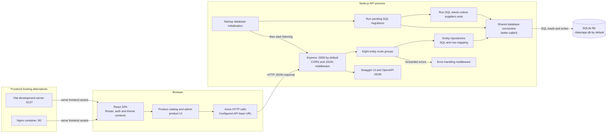

# Implemented application architecture

This diagram describes the checked-in React frontend and Express API. Arrows show
asset delivery, HTTP requests, or internal calls; they do not imply that any
particular deployment is running.

## How it works

The [React application](frontend/src/App.tsx) provides home, about, products,
login, and admin-products routes. The catalog reads products; the admin UI reads
products and suppliers and creates, updates, or deletes products. These browser
requests use [API URL configuration](frontend/src/api/config.ts), which prefers
runtime configuration, then a Codespaces URL, then the current hostname on port
3000. [Login state](frontend/src/context/AuthContext.tsx) is an in-memory demo:
it does not validate credentials with the API or provide server-side authorization.

The [API entry point](api/src/index.ts) mounts routes for suppliers, products,
headquarters, branches, orders, order details, deliveries, and order-detail
deliveries. Routes call repositories, which execute SQL through a shared
`better-sqlite3` connection and map database columns to TypeScript model fields.
Swagger UI is exposed at `/api-docs` and its JSON at `/api-docs.json`.

Before listening, the API runs pending migrations and attempts seeding; the
seeder skips inserts when suppliers already exist. The default database path
is relative to the API process working directory (`api/data/app.db` when started
from `api/`), and `DB_FILE` can override it. Foreign keys and WAL are enabled by
default; the test connection configuration uses `:memory:`.

For containers, [Docker Compose](docker-compose.yml) builds separate API and
frontend images and publishes host ports 3000 and 3001 respectively. Nginx serves
the SPA with an index-page fallback; it does not proxy API requests. The frontend
[container entrypoint](frontend/entrypoint.sh) generates `runtime-config.js`, so
the configured API URL must be reachable by the browser. Compose declares no
database volume.

## Key implementation files

| Area | Source |
| --- | --- |
| Browser entry and routes | [main.tsx](frontend/src/main.tsx), [App.tsx](frontend/src/App.tsx) |
| Product UI and requests | [Products.tsx](frontend/src/components/entity/product/Products.tsx), [AdminProducts.tsx](frontend/src/components/admin/AdminProducts.tsx), [ProductForm.tsx](frontend/src/components/entity/product/ProductForm.tsx) |
| API middleware and route registration | [index.ts](api/src/index.ts), [routes](api/src/routes), [error handler](api/src/utils/errors.ts) |
| Data-access pattern | [productsRepo.ts](api/src/repositories/productsRepo.ts), [SQL helpers](api/src/utils/sql.ts), [models](api/src/models) |
| SQLite connection and defaults | [sqlite.ts](api/src/db/sqlite.ts), [config.ts](api/src/db/config.ts) |
| Startup and schema management | [init-db.ts](api/src/init-db.ts), [migration runner](api/src/db/migrate.ts), [seed runner](api/src/db/seed.ts), [SQL migrations](api/database/migrations), [SQL seeds](api/database/seed) |
| OpenAPI generation | [swagger-options.ts](api/src/swagger-options.ts), [route annotations](api/src/routes/product.ts) |
| Development and container hosting | [vite.config.ts](frontend/vite.config.ts), [Nginx configuration](frontend/nginx.conf), [frontend Dockerfile](frontend/Dockerfile), [API Dockerfile](api/Dockerfile), [docker-compose.yml](docker-compose.yml) |
