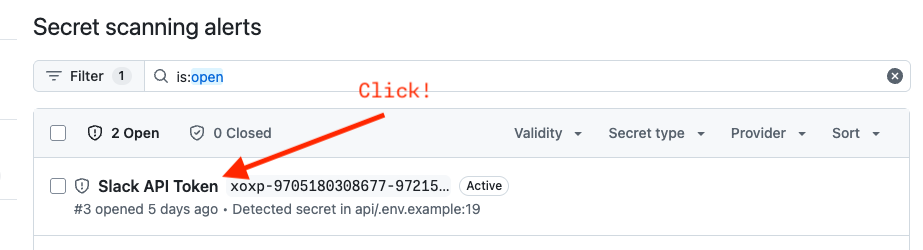
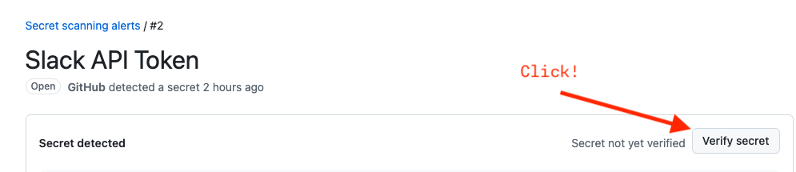
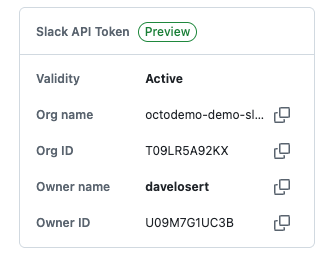

# Secret Scanning

### Main Branch: Leaked Secrets

- **id**: walkthrough.ghas.secret-scanning-existing
- **Capabilities:** [Secret Scanning](../../capabilities/secret-scanning.md#secret-scanning) (`capability.secret-scanning`)
- **Contents:** [Leaked RSA key](../../inventory.md) (`content.ca-key-secret`), [Leaked secrets in .env.example](../../inventory.md) (`content.env-example-secrets`), [Hardcoded database credentials](../../inventory.md) (`content.hardcoded-db-credentials`), [Hardcoded Slack bot token](../../inventory.md) (`content.hardcoded-slack-token`)

1. Go to the Repository -> Security -> Secrets
2. You will see several alerts across the `Default` and `Generic` tabs (the AI-detected alert can take a while to show up)
    1. **Default: GitHub PAT** - This got leaked within the `api/.env.example` file - however, another commit removed the secret again. You can showcase how Secret Scanning goes through the entire GitHub history
    2. **Default: Slack API Token** - A hardcoded bot token committed alongside the application code. The planted token is synthetic, so it is a good example for **validity checks** - the alert reports it as inactive. Extended metadata (see [Secret Scanning with Additional Metadata](#secret-scanning-with-additional-metadata--)) only populates for an **active** token, so that walkthrough needs a real one.
    3. **Generic: AI Detected Password** - A hardcoded database password sitting next to its username in the backend configuration, this is a so called `generic secret` detected by AI. It's supposed to be a project specific password, so you can demo how GitHub is also capable of detecting these.
    4. **Generic: RSA Token** - Leaked in `api/ca.key`, this is a so called `non-provider` pattern secret

       > [!NOTE]
       > The exact file paths depend on the backend the demo was provisioned with. The hardcoded credentials live in `api/src/db/config.ts` and `api/.env.example` (Node.js), `api/src/db/config.py` and `api/src/utils/notifications.py` (Python), `api/src/main/resources/application.properties` and `api/src/main/java/com/octodemo/octocatsupply/config/SlackNotificationConfig.java` (Java), or `api/config/database.php` and `api/config/services.php` (PHP). `api/ca.key` is present in every backend.

### Push Protection: Anthropic API Key

- **id**: walkthrough.ghas.push-protection
- **Capabilities:** [Push Protection](../../capabilities/secret-scanning.md#push-protection) (`capability.push-protection`)
- **Contents:** [Inject secrets patch](../../inventory.md) (`content.inject-secrets-patch`)

1. Apply the Patch Set `GHAS: Inject Secrets`[^1]
2. This will create a file `logs/debug.log` where you can find a leaked `anthropic` API key.
3. Commit the File
4. Open a terminal and enter `git push`
5. Observe push protection
6. (optional) Navigate to the bypass website contained in the push protection message and demo bypassing push-protection

### GitHub MCP Secret Scanning

- **id**: walkthrough.ghas.mcp-secret-scanning
- **Capabilities:** [GitHub MCP Security Scanning](../../capabilities/code-scanning.md#github-mcp-security-scanning) (`capability.github-mcp-security-scanning`), [Copilot CLI](../../capabilities/copilot-cli.md#copilot-cli) (`capability.copilot-cli`)
- **Contents:** [Inject secrets patch](../../inventory.md) (`content.inject-secrets-patch`), [MCP config](../../inventory.md) (`content.mcp-config`), [Advanced security skill](../../inventory.md) (`content.advanced-security-skill`)

1. Apply the Patch Set `GHAS: Inject Secrets`[^1]
2. This will create a file `logs/debug.log` where you can find a leaked `anthropic` API key.
3. **Pre-commit scan via IDE** — With the [GitHub MCP Server](../copilot/mcp.md) started, open Copilot Chat in Agent mode and prompt:

   ```prompt
   Scan all current changes for exposed secrets and show me the files and lines I should update before I commit
   ```

   Copilot will invoke MCP secret scanning, returning the file, line number, and secret type for the leaked key.
4. **Pre-commit scan via CLI** — Open Copilot CLI in the terminal and prompt:

   ```prompt
   Use the secret scanning tool to check all changed files for any leaked secrets or credentials
   ```

   The CLI will surface the same findings through the MCP server. Note that the default MCP tools configuration does not include secret scanning. Start the CLI with `copilot --add-github-mcp-tool run_secret_scanning` or `copilot --enable-all-github-mcp-tools` for this demo.

---------

[^1]: To learn how to apply a patch-set, see [patch-sets.md](../../general/patch-sets.md)

### Secret Scanning with Additional Metadata 🔒 🤫

- **id**: walkthrough.ghas.secret-scanning-metadata
- **Capabilities:** [Secret Scanning](../../capabilities/secret-scanning.md#secret-scanning) (`capability.secret-scanning`)
- **Contents:** [Slack token alert](../../inventory.md) (`content.slack-token-alert`)

1. Navigate to the `Security` tab of your demo repository.
2. Click `Secret scanning -> Default`. You should see a leaked `Slack API Token`. Click it.
    
3. On the top right, click `Verify Secret`.
    
4. Navigate back to the secret alert from step 2. You should now see additional metadata about the leaked secret, its validity, `Org name`, and `Owner name`.

    
